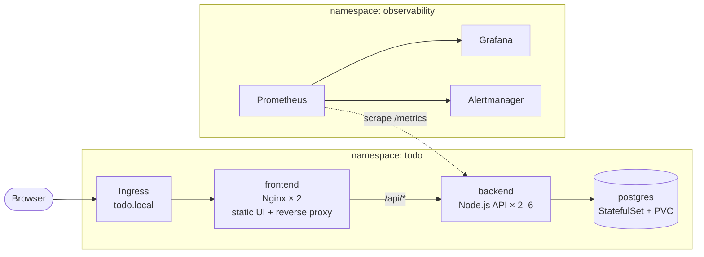
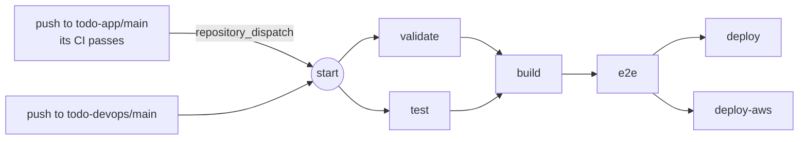

# TODO App — DevOps

Infrastructure for the TODO application: container images, the Nginx web server, Kubernetes
manifests, the CI/CD pipeline and monitoring.

The application itself (frontend and backend source) lives in the companion **todo-app**
repository. This repository never contains application code; it consumes that repository as a
build input.

| Component | Technology | Location |
| --- | --- | --- |
| Web server / reverse proxy | Nginx (unprivileged) | [`docker/frontend/nginx/`](docker/frontend/nginx/default.conf.template) |
| Container images | Docker, multi-stage, BuildKit | [`docker/`](docker/) |
| Local environment | Docker Compose | [`docker-compose.yml`](docker-compose.yml) |
| Orchestration | Kubernetes + Kustomize | [`k8s/`](k8s/) |
| Cloud infrastructure | Terraform → AWS (VPC, EKS, ALB) | [`terraform/`](terraform/README.md) |
| CI/CD | GitHub Actions | [`.github/workflows/cicd.yml`](.github/workflows/cicd.yml) |
| Monitoring | Prometheus, Grafana, Alertmanager | [`monitoring/`](monitoring/) |
| Automation | Bash scripts, Makefile | [`scripts/`](scripts/), [`Makefile`](Makefile) |

## Architecture



- **Nginx is the only entry point.** It serves the static UI and reverse-proxies `/api/` to the
  backend, with rate limiting, security headers, gzip and upstream keep-alive. The backend's
  `/metrics` and `/health` endpoints are not proxied, so they are unreachable from outside.
- **The backend is stateless** and runs as several replicas; all state is in PostgreSQL.
- **PostgreSQL** runs as a StatefulSet with a PersistentVolumeClaim.
- **NetworkPolicies** only allow ingress → frontend → backend → postgres, plus Prometheus → backend.

## Prerequisites

| Tool | Used for | Notes |
| --- | --- | --- |
| Docker with **Buildx** and the **Compose** plugin | Building images, local environment | Docker Desktop includes both. On Ubuntu: `sudo apt-get install docker-buildx docker-compose-v2` |
| `kubectl`, `minikube` | Kubernetes deployment | kind or k3s work as well |
| `helm` | Installing the monitoring stack | |
| `terraform` ≥ 1.10, AWS CLI v2 | AWS deployment only | See [`terraform/README.md`](terraform/README.md) |
| `make` | Optional shortcuts | Every target is a thin wrapper around a command shown below |

Both repositories are expected side by side:

```
some-folder/
├── todo-app/       application repository
└── todo-devops/    this repository
```

If the application repository is somewhere else, set `APP_REPO_PATH`.

> **Why Buildx is required.** The Dockerfiles live here while the source lives in another
> repository, so the source is passed as a *named build context*
> (`--build-context app=../todo-app`). That is a BuildKit feature; the legacy builder cannot do it.

## Quick start: Docker Compose

```bash
cp .env.example .env        # then set DB_PASSWORD and GRAFANA_ADMIN_PASSWORD
                            # (generate one with: openssl rand -base64 24)

docker compose up --build -d                       # app only
docker compose --profile monitoring up --build -d  # app + Prometheus + Grafana
```

| URL | What |
| --- | --- |
| <http://localhost:8080> | The application (Nginx) |
| <http://localhost:9090> | Prometheus (monitoring profile) |
| <http://localhost:3001> | Grafana — log in with `admin` and your `GRAFANA_ADMIN_PASSWORD`; the *TODO Backend* dashboard is the home page (monitoring profile) |

```bash
scripts/smoke-test.sh http://localhost:8080   # end-to-end check
docker compose --profile monitoring down      # stop (add -v to also delete the data)
```

## Quick start: Kubernetes (minikube)

```bash
scripts/local-up.sh          # or: make k8s-up
```

This starts minikube, enables the ingress and metrics-server addons, builds both images, loads
them into the cluster, creates the database secret, applies the manifests and waits for the
rollout. Then:

```bash
kubectl -n todo port-forward svc/frontend 8080:80   # → http://localhost:8080
scripts/smoke-test.sh http://localhost:8080
```

To use the Ingress instead of a port-forward, map the hostname to the cluster:

```bash
echo "$(minikube ip) todo.local" | sudo tee -a /etc/hosts   # → http://todo.local
```

(With the Docker driver on macOS/Windows, run `minikube tunnel` and map `todo.local` to `127.0.0.1`.)

### Monitoring on Kubernetes

```bash
scripts/monitoring-up.sh     # or: make k8s-monitoring
```

Installs the `kube-prometheus-stack` Helm chart into the `observability` namespace and applies the
TODO-specific resources. The Grafana admin password is generated and stored in a Secret; the
script prints the command to read it.

```bash
kubectl -n observability port-forward svc/kube-prometheus-stack-grafana 3001:80          # → http://localhost:3001
kubectl -n observability port-forward svc/kube-prometheus-stack-prometheus 9090:9090     # → http://localhost:9090
```

### Clean up

```bash
kubectl delete namespace todo                                            # the application and its data
helm -n observability uninstall kube-prometheus-stack                    # the monitoring stack
kubectl delete namespace observability
```

## Deploying to AWS (Terraform + EKS)

[`terraform/`](terraform/README.md) creates a production-style AWS environment: a VPC with
private worker nodes, an EKS cluster with NetworkPolicy enforcement, the AWS Load Balancer
Controller, encrypted EBS storage, ECR repositories for the images, and a keyless (OIDC) deploy
role for GitHub Actions. The application is then deployed with the `aws` overlay - the same
manifests, exposed through an Application Load Balancer - either from your machine (images pushed
to ECR) or by the pipeline's **deploy-aws** job.

```bash
make aws-plan && make aws-up     # 1. create the environment (after the setup in terraform/README.md)

# 2. push the images to ECR and deploy - full commands in terraform/README.md
IMAGE_REGISTRY=<ecr registry> IMAGE_TAG=<tag> scripts/deploy.sh aws
kubectl -n todo get ingress todo # 3. ADDRESS = the application URL (live after 2-3 minutes)

make aws-down                    # tear everything down again
```

> It costs roughly **$0.32 per hour** while it exists. Destroy it when you are not using it.

It also runs in **AWS Academy Learner Lab**, which forbids creating IAM roles: set
`existing_iam_role_name = "LabRole"` and the lab's role is reused instead.

Full instructions - creating the environment, [deploying and updating the
application](terraform/README.md#deploying-the-application), security design, costs and the
Learner Lab specifics: [`terraform/README.md`](terraform/README.md).

## Docker images

| Image | Base | Runs as | Notes |
| --- | --- | --- | --- |
| `todo-backend` | `node:24-alpine` | `node` (UID 1000) | Multi-stage: `prod-deps` → `test` → `runtime` |
| `todo-frontend` | `nginxinc/nginx-unprivileged:1.29-alpine` | `nginx` (UID 101) | Static files + Nginx config, listens on 8080 |

```bash
scripts/build-images.sh local                 # builds todo-backend:local and todo-frontend:local
RUN_TESTS=true scripts/build-images.sh local  # also runs lint + tests in the `test` stage
```

Practices applied:

- **Multi-stage build** — dev dependencies and tests never reach the runtime image.
- **Layer caching** — dependency manifests are copied and installed before the source code, and
  the npm cache is a BuildKit cache mount.
- **Non-root** — both images run as an unprivileged user; application files are owned by root and
  read-only to that user.
- **Read-only root filesystem, all capabilities dropped, no privilege escalation** — enforced in
  both Compose and Kubernetes. Only explicit `tmpfs`/`emptyDir` mounts are writable.
- **`tini` as PID 1** — signals reach Node.js, so `SIGTERM` triggers a graceful shutdown.
- **`HEALTHCHECK`** in both images; pinned base image versions; no secrets in any layer.

## Kubernetes

```
k8s/
├── base/                    environment-independent manifests
│   ├── namespace.yaml       namespace with the `restricted` Pod Security Standard enforced
│   ├── backend/             Deployment, Service, ConfigMap, PodDisruptionBudget, ServiceAccount
│   ├── frontend/            Deployment, Service, PodDisruptionBudget, ServiceAccount
│   ├── postgres/            StatefulSet (+ volumeClaimTemplate), headless Service, ServiceAccount
│   ├── ingress.yaml         todo.local → frontend
│   └── networkpolicy.yaml   default deny + per-tier allow rules
└── overlays/
    ├── local/               images built on this machine (`:local`), debug logging
    ├── production/          registry images pinned by tag, HorizontalPodAutoscaler, pull secret
    └── aws/                 production + exposed through an AWS Application Load Balancer
```

| Practice | Where |
| --- | --- |
| Namespaces | `todo` for the app, `observability` for monitoring |
| ConfigMap for settings, Secret for credentials | [`backend/configmap.yaml`](k8s/base/backend/configmap.yaml), [`scripts/ensure-secrets.sh`](scripts/ensure-secrets.sh) |
| Resource requests and limits | every container |
| Startup, liveness and readiness probes | every container; backend liveness does *not* depend on the database, readiness does |
| Zero-downtime rollouts | `maxUnavailable: 0`, `preStop` delay, graceful shutdown, PodDisruptionBudgets |
| Autoscaling | [`HorizontalPodAutoscaler`](k8s/overlays/production/hpa.yaml), 2–6 replicas on CPU |
| Least privilege | non-root, read-only root FS, dropped capabilities, seccomp, no ServiceAccount token, NetworkPolicies |
| Persistent data | StatefulSet with a PersistentVolumeClaim |

### Secrets

No secret is stored in this repository. `scripts/ensure-secrets.sh` (called by `deploy.sh`) creates
the Secret `todo-db-credentials` on first deployment — from `DB_USER` / `DB_PASSWORD` if set,
otherwise with a randomly generated password — and leaves it untouched afterwards.

> The password is only read by PostgreSQL when it initialises its data volume. To change it later,
> change it in the database first (`ALTER USER ... PASSWORD ...`), then update the Secret.

### Deploying

```bash
scripts/deploy.sh local                              # images loaded into the cluster

IMAGE_REGISTRY=ghcr.io/<owner> IMAGE_TAG=<tag> \
  scripts/deploy.sh production                       # images from a registry
```

`deploy.sh` applies the manifests, waits for every rollout, and **rolls a Deployment back to its
previous revision** if the new one does not become healthy.

## CI/CD pipeline

[`.github/workflows/cicd.yml`](.github/workflows/cicd.yml) — GitHub Actions.



| Job | What it does |
| --- | --- |
| **validate** | Lints the Dockerfiles (hadolint) and scripts (shellcheck); validates the Kubernetes manifests (kubeconform), the Compose file, the Prometheus config and alert rules (promtool) and the dashboard JSON; format-checks, validates and security-scans (Trivy) the Terraform code |
| **test** | Checks out the application repository; installs, lints and runs the full test suite against a PostgreSQL service container; audits dependencies |
| **build** | Builds both images with Buildx (layer cache in GitHub Actions cache), scans them with Trivy, pushes them to GitHub Container Registry |
| **e2e** | Creates a throwaway kind cluster, deploys the just-pushed images with the real manifests, runs the smoke test |
| **deploy** | Deploys to the target cluster from a self-hosted runner, then smoke-tests it; rolls back on failure |
| **deploy-aws** | Promotes the tested images from GHCR to the environment's ECR (exact copy, same digest), deploys them to EKS with temporary AWS credentials (GitHub OIDC, no stored keys; Learner Lab: the lab's session keys), smoke-tests it and publishes the load balancer URL; see [`terraform/README.md`](terraform/README.md) |

Details:

- **Triggers** — a push to `main` here, a `repository_dispatch` event sent by the application
  repository's CI when its `main` branch is green, or a manual run. Pull requests run
  validate / test / build without pushing anything.
- **Image tags are immutable and traceable**: `<app commit>-<devops commit>`, e.g. `3f2a91c-b07d4e2`.
  `latest` is also pushed for convenience but never deployed.
- **The exact commit that was tested is the one that gets built**, and the exact image that passed
  the e2e job is the one that gets deployed.
- **Credentials** — pushing uses the short-lived, automatically provided `GITHUB_TOKEN`. Workflow
  permissions default to read-only and are widened per job. No long-lived registry password exists.

### Setting it up

1. Push both repositories to GitHub (`<owner>/todo-app` and `<owner>/todo-devops`).
2. The pipeline now works up to and including the **e2e** job with no further configuration.
3. Optional settings (*Settings → Secrets and variables → Actions*):

| Kind | Name | Needed when |
| --- | --- | --- |
| Variable | `APP_REPOSITORY` | The application repository is not `<owner>/todo-app` |
| Secret | `APP_REPO_TOKEN` | The application repository is private (token with read access to it) |
| Variable | `DEPLOY_ENABLED` = `true` | You want the **deploy** job to run |
| Secret | `KUBE_CONFIG` | The runner should use a specific kubeconfig (base64-encoded) instead of its own |
| Secret | `DB_PASSWORD` | You want to choose the database password instead of generating it |
| Secrets | `REGISTRY_PULL_USERNAME`, `REGISTRY_PULL_TOKEN` | The images are private (token with `read:packages`) |

### Deploying to a local cluster from GitHub Actions

GitHub-hosted runners cannot reach a cluster on your machine, so the **deploy** job runs on a
[self-hosted runner](https://docs.github.com/en/actions/hosting-your-own-runners):

1. On the machine that runs minikube: *Settings → Actions → Runners → New self-hosted runner* in
   this repository, and follow the instructions. The runner needs `kubectl` and `curl`.
2. Set the repository variable `DEPLOY_ENABLED` to `true`.
3. Either make the two GHCR packages public, or add the `REGISTRY_PULL_*` secrets.

The deploy job never runs for pull requests, so code from a fork cannot execute on the runner.
For a public repository, also restrict the `production` environment to the `main` branch.

## Monitoring and observability

```
monitoring/
├── dashboards/todo-backend.json     Grafana dashboard — single source for both environments
├── prometheus/                      scrape config + alert rules for Docker Compose
├── grafana/provisioning/            datasource + dashboard provisioning for Docker Compose
├── kubernetes/
│   ├── values.yaml                  Helm values for kube-prometheus-stack
│   ├── servicemonitor.yaml          scrape the backend pods
│   └── prometheusrule.yaml          alert rules
└── kustomization.yaml               ServiceMonitor + rules + dashboard ConfigMap
```

**Application metrics** (exposed by the backend on `/metrics`):

| Metric | Type | Meaning |
| --- | --- | --- |
| `http_requests_total{method,route,status_code}` | counter | Requests handled |
| `http_request_duration_seconds{method,route,status_code}` | histogram | Request latency |
| `http_requests_in_flight` | gauge | Requests currently being processed |
| `todos_created_total`, `todos_completed_total`, `todos_deleted_total` | counter | Business activity |
| `todos_current{status}` | gauge | Todos in the database by status |
| `process_*`, `nodejs_*` | — | CPU, memory, event-loop lag, GC, heap |

The `route` label is the route *pattern* (`/api/v1/todos/:id`), never the raw URL, to keep
cardinality bounded.

**Infrastructure metrics** on Kubernetes come with `kube-prometheus-stack`: node-exporter (nodes),
kube-state-metrics (workloads), kubelet/cAdvisor (containers), each with ready-made dashboards.

**Dashboard** — *TODO Backend*: instances up, request rate, 5xx ratio and p95 latency at a glance;
traffic by status code and route; latency percentiles; todo activity; Node.js memory, CPU,
event-loop lag and restarts.

**Alerts**:

| Alert | Fires when |
| --- | --- |
| `TodoBackendDown` | No backend instance has been scraped successfully for 2 minutes |
| `TodoBackendHighErrorRate` | More than 5% of requests return 5xx for 5 minutes |
| `TodoBackendHighLatency` | API p95 latency above 500 ms for 10 minutes |
| `TodoBackendEventLoopLag` | Node.js p99 event-loop lag above 200 ms for 10 minutes |

**Logs** — both Nginx and the backend log to stdout; the backend logs structured JSON. Nginx
generates an `X-Request-Id`, forwards it to the backend and both log it, so one request can be
followed across the two tiers (`kubectl -n todo logs -l app.kubernetes.io/part-of=todo --prefix`).

## Security summary

- No credentials in Git: `.env`, kubeconfigs and secret manifests are git-ignored; Kubernetes
  Secrets are created at deploy time; CI uses GitHub secrets and the ephemeral `GITHUB_TOKEN`.
- Containers run as non-root with a read-only root filesystem, no capabilities, seccomp
  `RuntimeDefault`; the namespace enforces the `restricted` Pod Security Standard.
- Pods get no Kubernetes API token.
- The database and the API are not reachable from outside the cluster; only Nginx is exposed.
- Nginx applies per-client rate limiting, a strict Content-Security-Policy and request size limits.
- Images are scanned (Trivy) before they are pushed; production dependencies are audited in CI.
- Compose binds every published port to `127.0.0.1` and puts the database on an internal network.

## Troubleshooting

| Symptom | Cause / fix |
| --- | --- |
| `unknown flag: --build-context` | Docker Buildx is missing — see [Prerequisites](#prerequisites) |
| `docker: unknown command: docker compose` | The Compose plugin is missing — see [Prerequisites](#prerequisites) |
| Backend pods `CrashLoopBackOff` with `password authentication failed` | The Secret was recreated but the database volume still has the old password. Either restore the old Secret or delete the namespace (and with it the volume) and redeploy |
| Pods `ErrImagePull` on minikube with the `local` overlay | The images are not in the cluster: `minikube image load todo-backend:local todo-frontend:local` |
| Pods `ImagePullBackOff` with the `production` overlay | The GHCR packages are private: make them public or provide `REGISTRY_USERNAME` / `REGISTRY_TOKEN` |
| `http://todo.local` does not resolve | Add it to `/etc/hosts` (see above) or use the port-forward |
| HorizontalPodAutoscaler shows `<unknown>` | metrics-server is not installed: `minikube addons enable metrics-server` |
