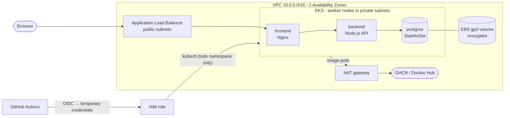

# AWS deployment (Terraform + EKS)

Terraform code that creates a production-style AWS environment for the TODO application. The
application is then deployed by the existing CI/CD pipeline, with the same Kubernetes manifests
used locally.

It runs in two modes, selected by one variable:

| Mode | For | IAM |
| --- | --- | --- |
| **Standard** (default) | A regular AWS account | Dedicated least-privilege roles for the cluster, the nodes and each controller; keyless GitHub OIDC deploys |
| **Existing role** (`existing_iam_role_name = "LabRole"`) | Sandboxes that forbid creating IAM roles, such as **AWS Academy Learner Lab** | One pre-existing role for everything; the pipeline uses the sandbox's temporary keys. See [AWS Academy Learner Lab](#aws-academy-learner-lab) |

```
terraform/
├── bootstrap/          one-time: S3 bucket for the Terraform state (local state)
├── eks/                the environment (state in the bootstrap bucket)
│   ├── vpc.tf          VPC, public + private subnets in 2 AZs, NAT gateway
│   ├── eks.tf          EKS cluster, managed node group, core add-ons, IAM roles
│   ├── addons.tf       AWS Load Balancer Controller, metrics-server (Helm)
│   ├── kubernetes.tf   default gp3 StorageClass, `todo` namespace, deploy RBAC
│   ├── github-oidc.tf  keyless GitHub Actions → AWS trust
│   └── ...             versions, providers, variables, outputs
└── .trivyignore.yaml   accepted security-scan findings, each with its justification
```

## Architecture



| Layer | What Terraform creates |
| --- | --- |
| Network | VPC with public subnets (load balancer, NAT) and private subnets (nodes) in two Availability Zones; one NAT gateway |
| Cluster | EKS (Kubernetes 1.36) with public + private API endpoint, audit/authenticator logs to CloudWatch (7-day retention), Secrets encrypted with a dedicated KMS key |
| Nodes | Managed node group, 3 × `t3.medium` (Amazon Linux 2023) in private subnets, rolling updates one node at a time |
| Cluster add-ons | VPC CNI **with NetworkPolicy enforcement**, CoreDNS, kube-proxy, EKS Pod Identity agent, EBS CSI driver, AWS Load Balancer Controller, metrics-server |
| Kubernetes | Default encrypted `gp3` StorageClass; the `todo` namespace; RBAC for the deploy identity |
| CI/CD access | GitHub OIDC provider and a deploy role that only a job in the `aws` environment of your DevOps repository can assume |

The PostgreSQL database stays in the cluster as the existing StatefulSet. Its data lives on an
encrypted EBS volume that is created automatically through the default StorageClass.

The cluster is written with plain `aws_eks_*` resources rather than the popular
`terraform-aws-modules/eks` module: that module always looks up the caller's IAM role with
`iam:GetRole`, which Learner Lab explicitly denies, so it cannot run there.

## What it costs

These resources are billed **per hour while they exist**, whether or not anyone uses the app.
Approximate on-demand prices in `us-east-1`; check the AWS pricing pages for your region.

| Resource | ≈ per hour |
| --- | --- |
| EKS control plane | $0.10 |
| 3 × t3.medium nodes | $0.125 |
| NAT gateway (+ data processed) | $0.045 |
| Application Load Balancer | $0.025 |
| Public IPv4 addresses, EBS volumes, CloudWatch logs, KMS key | ~$0.03 |
| **Total** | **≈ $0.32/hour - about $8/day, $230/month** |

Set `node_capacity_type = "SPOT"` to cut the node cost by roughly two thirds. **Destroy the
environment when you are not demonstrating it** (see [Tearing down](#tearing-down)). On a Learner
Lab budget, a cluster left running uses about $8 of it per day.

## Prerequisites

- An AWS account and credentials allowed to manage VPC, EC2, EKS, IAM, KMS, S3 and CloudWatch Logs
  (for a personal account: an administrator user or SSO role).
- [Terraform](https://developer.hashicorp.com/terraform/install) **1.10 or newer** (native S3 state locking).
- [AWS CLI **v2**](https://docs.aws.amazon.com/cli/latest/userguide/getting-started-install.html).
  AWS CLI v1 before 1.24 writes kubeconfig entries that current kubectl versions reject.
- `kubectl` and `helm`.

## Setting it up

### 1. Create the state bucket (once per account)

```bash
terraform -chdir=terraform/bootstrap init
terraform -chdir=terraform/bootstrap apply
terraform -chdir=terraform/bootstrap output -raw backend_config > terraform/eks/backend.hcl
```

The bucket is versioned, encrypted, blocks public access and refuses non-TLS requests. Terraform
locks the state with a lock file in the bucket, so two people (or a person and a pipeline) cannot
apply at the same time.

### 2. Configure the environment

```bash
cp terraform/eks/terraform.tfvars.example terraform/eks/terraform.tfvars
```

Set at least `github_repository` to your DevOps repository (`<owner>/todo-devops`). All inputs
are described in [`eks/variables.tf`](eks/variables.tf).

### 3. Create the environment

```bash
make aws-plan    # terraform init + plan; review what will be created
make aws-up      # apply that plan (about 15-20 minutes), then configure kubectl
```

or without `make`:

```bash
terraform -chdir=terraform/eks init -backend-config=backend.hcl
terraform -chdir=terraform/eks plan -out=eks.tfplan
terraform -chdir=terraform/eks apply eks.tfplan
$(terraform -chdir=terraform/eks output -raw configure_kubectl)
```

### 4. Let the pipeline deploy

1. In the DevOps repository on GitHub, create an environment named **`aws`** (*Settings →
   Environments*). Restrict it to the `main` branch, and add yourself as a required reviewer if
   every AWS deployment should wait for approval.
2. Add the repository variables printed by
   `terraform -chdir=terraform/eks output github_actions_variables`:
   `AWS_DEPLOY_ENABLED`, `AWS_REGION`, `AWS_ROLE_ARN`, `EKS_CLUSTER_NAME`.
   (Learner Lab: different credentials, see [below](#aws-academy-learner-lab).)
3. The images in GHCR are private by default. Either make the `todo-backend` and `todo-frontend`
   packages public, or add the secrets `REGISTRY_PULL_USERNAME` and `REGISTRY_PULL_TOKEN` (a token
   with `read:packages`).
4. Push to `main` or start the workflow manually. The **deploy-aws** job deploys the release that
   passed the kind end-to-end test, smoke-tests it and publishes the load balancer URL in the run
   summary.

To deploy from your own machine instead (as cluster admin):

```bash
IMAGE_REGISTRY=ghcr.io/<owner> IMAGE_TAG=<tag> scripts/deploy.sh aws
kubectl -n todo get ingress todo    # ADDRESS column = the application URL
```

Monitoring works unchanged on EKS: `scripts/monitoring-up.sh`.

## AWS Academy Learner Lab

The lab is a restricted sandbox. These limits shape this mode (all verified against a lab
account):

| Lab limit | Consequence |
| --- | --- |
| Only `us-east-1` and `us-west-2` | Keep the default region `us-east-1` in **both** stacks |
| No creating IAM roles or OIDC providers | The cluster, nodes and controllers all use the lab's `LabRole`; no GitHub OIDC role |
| `LabRole` does not trust `pods.eks.amazonaws.com` | No EKS Pod Identity: the EBS CSI driver and load balancer controller use the node's `LabRole` credentials |
| Reading the `voclabs` session role is denied | The cluster grants its creator admin through EKS itself (`bootstrap_cluster_creator_admin_permissions`) |
| AWS Shield is denied | The load balancer controller's WAF/Shield integrations are switched off (the app does not use them) |
| Credentials end with the lab session | Every AWS call starts failing with an explicit deny from `voc-cancel-cred`; start the lab again and refresh the credentials |

### Steps

1. In the lab, **Start Lab**, then open **AWS Details → AWS CLI** and paste the three lines into
   `~/.aws/credentials` under `[default]`. Repeat this every time a new lab session starts.
2. Follow [Setting it up](#setting-it-up), with this in `terraform/eks/terraform.tfvars`:

   ```hcl
   aws_region             = "us-east-1"
   existing_iam_role_name = "LabRole"
   github_repository      = "<owner>/todo-devops"
   ```

3. For the pipeline: in the `aws` environment of the DevOps repository, add the secrets
   `AWS_ACCESS_KEY_ID`, `AWS_SECRET_ACCESS_KEY` and `AWS_SESSION_TOKEN` from the same lab page, and
   the variables `AWS_DEPLOY_ENABLED`, `AWS_REGION`, `EKS_CLUSTER_NAME` printed by
   `terraform output github_actions_variables`. Do **not** set `AWS_ROLE_ARN`: that is what tells
   the job to use the keys. The keys stop working when the lab session ends, so update the three
   secrets before each deployment in a new session.

### What this mode gives up

Say so if you present it: these are the lab's constraints, not the design of choice.

- **Shared role.** Cluster, nodes and controllers share `LabRole`. Pods can reach the node's
  metadata service (hop limit 2), so any pod could obtain `LabRole` credentials. In standard mode
  each controller has its own role and pods cannot reach the node's credentials.
- **Stored, broad deploy credentials.** The pipeline uses the lab session's keys, which act as
  cluster admin, instead of a keyless role confined to the `todo` namespace.

## Security design

This describes the standard mode; see [What this mode gives up](#what-this-mode-gives-up) for the
differences in Learner Lab.

- **No AWS keys anywhere.** GitHub Actions authenticates with its OIDC token; the role's trust
  policy accepts only the `aws` environment of one repository, so branches, pull requests and
  other repositories cannot assume it. Credentials expire with the job.
- **Least-privilege deploy identity.** The role's only AWS permission is `eks:DescribeCluster`.
  Inside Kubernetes it maps to the group `todo-deployers`, which has the built-in `admin` role in
  the `todo` namespace only, plus read/patch on that one namespace object. It cannot touch other
  namespaces, nodes or cluster-wide resources. This is why Terraform, not the pipeline, creates
  the namespace.
- **Per-controller IAM.** The EBS CSI driver and the load balancer controller each get their own IAM
  role through EKS Pod Identity. Nodes require IMDSv2 with a hop limit of 1, so pods cannot reach
  the node's credentials.
- **Private nodes.** Worker nodes have no public IP; only the load balancer is internet-facing.
- **Encryption.** Kubernetes Secrets are envelope-encrypted with KMS; EBS volumes and the state
  bucket are encrypted.
- **Network policies are enforced.** The VPC CNI's network policy agent is enabled, so the
  application's default-deny policies apply on EKS.
- **Scanned in CI.** Every pipeline run checks formatting, validates both stacks and scans them with
  Trivy. Accepted findings are listed with their reasons in
  [`.trivyignore.yaml`](.trivyignore.yaml): the public API endpoint and its open CIDR range (needed
  by GitHub-hosted runners), node egress (image pulls) and SSE-S3 instead of a customer-managed key
  for the state bucket.

## Tearing down

```bash
make aws-down    # or: terraform -chdir=terraform/eks destroy
```

The destroy order is encoded in Terraform: the `todo` namespace is deleted first, while the load
balancer controller and EBS CSI driver are still running, so they remove the ALB and the database
volume before the cluster and VPC go. Nothing is left behind that keeps costing money.

This **permanently deletes the application's data**.

The state bucket survives (`prevent_destroy`) and costs cents per month. To remove it as well,
empty it, delete the `prevent_destroy` line in `bootstrap/main.tf`, and run
`terraform -chdir=terraform/bootstrap destroy`.

## Troubleshooting

| Symptom | Cause / fix |
| --- | --- |
| `explicit deny ... policy/voc-cancel-cred` | The Learner Lab session has ended: start the lab again and paste the new credentials into `~/.aws/credentials` (and the GitHub secrets) |
| `UnauthorizedOperation` on `DescribeAvailabilityZones` (Learner Lab) | The region is not allowed in the lab: use `us-east-1` or `us-west-2` |
| `AccessDenied` on `iam:CreateRole` | The account forbids creating IAM roles: set `existing_iam_role_name` (e.g. `"LabRole"`) |
| `EntityAlreadyExists` for the OIDC provider | The account already has GitHub's OIDC provider: set `create_github_oidc_provider = false` |
| `exec plugin ... v1alpha1` from kubectl | AWS CLI v1 is too old; install AWS CLI v2 and re-run `aws eks update-kubeconfig` |
| `deploy-aws` fails at *Configure AWS credentials* | The job must run in the `aws` environment and `github_repository` must match the repository exactly (case-sensitive) |
| `deploy-aws` fails with `forbidden` from kubectl | The deploy role can only act in the `todo` namespace; check the namespace exists (`terraform apply` creates it) |
| Pods `ImagePullBackOff` | GHCR packages are private: make them public or add the `REGISTRY_PULL_*` secrets |
| PostgreSQL pod `Pending` | `kubectl get pvc -n todo`: the EBS CSI driver or the gp3 StorageClass is missing; re-run `terraform apply` |
| Ingress has no ADDRESS | `kubectl -n kube-system logs deploy/aws-load-balancer-controller`; the public subnets need the `kubernetes.io/role/elb` tag (set by Terraform) |
| `terraform destroy` stuck on the VPC | An ALB or ENI created outside Terraform still exists, e.g. the namespace was deleted by hand while the controller was gone. Delete the leftover load balancer in the EC2 console and re-run destroy |
